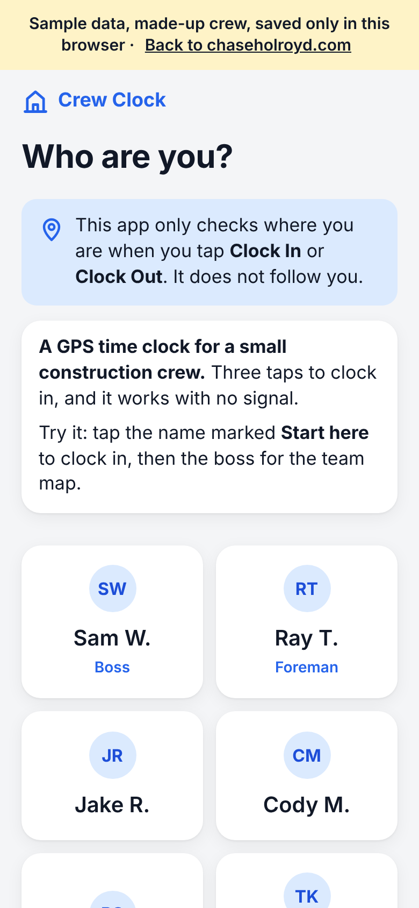
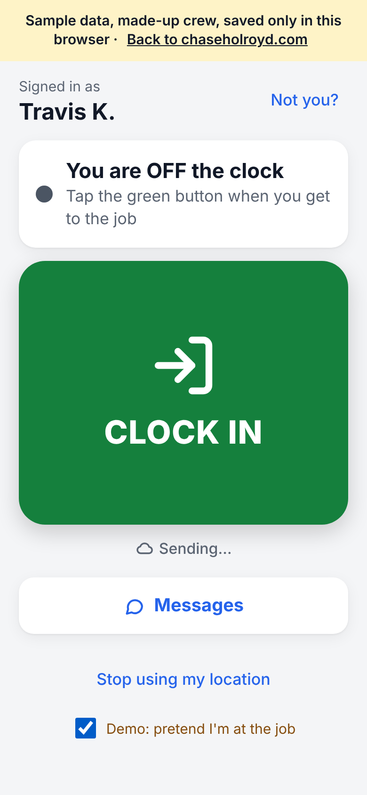
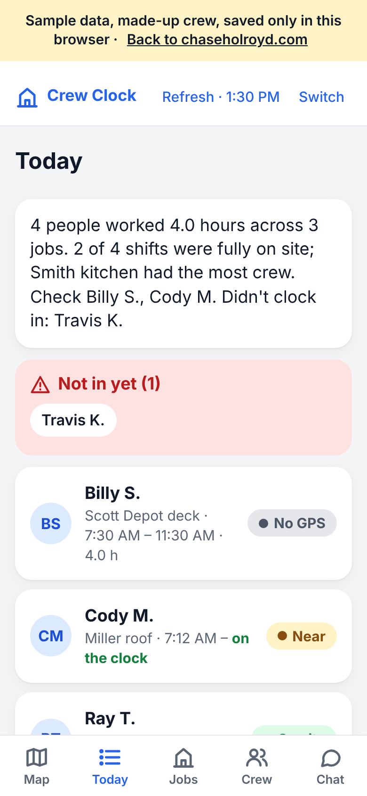

# Crew Clock

A phone time clock for a small construction crew in rural West Virginia: clock in with three
taps, even with no signal.

## Try the demo

**[chaseholroyd.com/crew-clock](https://chaseholroyd.com/crew-clock/)** works on a phone or a
laptop. No sign-up. It runs on a made-up crew, and everything you do stays in your browser.

  
  
  

## Why I built it

My dad runs a small construction crew. His job sites are rural, often with one bar of signal or
none. The crew uses cheap phones and doesn't want another app to learn. He needed to know who
showed up, where and when, without paper timesheets and without tracking anyone all day.

So the rules were: three taps, works offline, fair to the worker, and $0 to run. The crew's real
app is getting ready for a two-week beta with five workers. The demo is the same app on sample
data.

## What to try in 90 seconds

1. Tap **Travis K.**, the name marked **Start here**, then **Clock In** and pick a job. The demo
   starts with "pretend I'm at the job" on, so it never asks for your real location and the
   clock-in lands "On site". Uncheck it on Home to try your own GPS.
2. Tap **Not you?**, then **Billy S.** He hasn't agreed to location use yet, so you'll see the
   one-line consent screen first.
3. Tap **Not you?**, then **Sam W.** (the boss). See the team **Map**, the **Today** list with
   "Not in yet" and hours, and the **Jobs** and **Crew** tabs. Before 9 AM your time the sample
   crew's day is yesterday's, labeled "Yesterday (sample day)".

Every demo screen has a banner that says it's sample data, with a link back to chaseholroyd.com.

## Product decisions

- **Never block a clock-in.** Bad GPS or no signal never means "you can't clock in." The worker
  takes a picture instead, or the punch is flagged for the boss to look at.
- **A fair geofence.** Phone GPS can be off by a lot in the hills. The app counts that error in the
  worker's favor, so a worker standing on the site isn't turned away because the phone was unsure.
- **Works with no signal.** The phone saves the time and location at the tap and sends them when
  signal comes back.
- **Location only at the tap, and only with consent.** The app reads location only while you clock
  in or out. No background tracking. Each worker agrees once on their own phone, and the app keeps
  a record of that (text version, time, device). Withdrawing adds a new record; old ones are never
  edited. Tests check that no other screen reads location.
- **Hard to fake, easy to check.** Each phone signs every punch with a key that can't be copied
  off the phone. The boss sees flags for things that look off, like a punch with no picture.
- **No names to type.** Workers tap their name and a PIN. The phone keeps a sign-in token, never
  the PIN.
- **The demo is not the crew app.** The public demo is its own build with no server address in it,
  so a visitor can never reach real crew data.

The full privacy contract is in [docs/PRIVACY.md](docs/PRIVACY.md).

## What the demo shows, and what only the crew app does

| Feature | In the demo | In the crew app |
| --- | --- | --- |
| Three-tap clock-in, offline queue, fair geofence, photo fallback | Yes | Yes |
| Location consent and withdrawal | Yes | Yes, stored on the server |
| Boss map, Today list, Jobs, Crew, "Wrong job? Fix it" | Yes | Yes |
| Signed punches and risk flags | Yes, checked in the browser | Yes, also checked on the server |
| Photo check (too dark or blurry, retake) | Yes | Yes |
| Plain-words day summary | Yes | Yes |
| Encrypted crew chat (MLS) | Yes, between demo people in one browser | Yes, the server sees only ciphertext |
| Push alerts to the boss's phone | No | Yes |
| Daily and weekly Google Sheets reports | No (the button says so) | Yes |
| On-phone AI photo labels and written summary | No (they download a model) | On phones that can run it |

The crew app is not live yet. Its server setup is waiting on accounts (see [HANDOFF.md](HANDOFF.md)).

## Run it locally

    npm run serve        # then open http://localhost:8123

With nothing configured it runs in demo mode, with data kept in the browser. You sign in by
tapping a name (all names are made up). To try the PIN screen, set `demoPin: true` in
`config.js`: Sam W. 1234, Ray T. (foreman) 3333, Jake R. 1111, Cody M. 2222.

To set up the crew app, follow [docs/SETUP.md](docs/SETUP.md) (about an hour).
Where things stand and what's next: [HANDOFF.md](HANDOFF.md). Milestones: [PLAN.md](PLAN.md).

## Stack

| Part | Choice |
| --- | --- |
| App | Progressive web app, plain JS, no build step (the MLS bundle is prebuilt) |
| Hosting | Demo: GitHub Pages, always built with `--demo`. Crew app: a separate Cloudflare Pages build (not set up yet) |
| Database, API | Supabase Postgres with row-level security; geofence and shift logic in SQL |
| Sign-in | Supabase Auth, asymmetric (ES256) keys |
| Server code | Supabase Edge Functions (Deno) |
| Photos | Backblaze B2, private bucket, presigned upload and view links |
| Alerts | Web push (VAPID) |
| Chat crypto | [ts-mls](https://github.com/LukaJCB/ts-mls), suite X25519 / AES-128-GCM / Ed25519 |
| On-phone AI | Plain-JS image checks; Transformers.js models on capable phones (crew app only) |
| Reports | Apps Script in a Google Sheet pulls a read-only export nightly |

No paid services, no analytics, no tracking scripts.

## Tests

    npm test                  # geofence, shifts, signatures, risk rules, AI helpers (node)
    npm run test:sql          # schema + row-level security on a local Postgres
    npm run test:edge         # Edge Function logic (deno)
    npm run test:mls          # MLS group chat (three people, late joiner)

    npm install --no-save playwright@1.56.1 http-server@14.1.1 axe-core@4.11.3
    node scripts/build-site.mjs dist --demo && npx http-server dist -p 8123 -c-1 -s &
    npm run test:e2e          # browser click-throughs, plus an axe accessibility check of every
                              # demo screen at phone and laptop size, light and dark

CI runs all of them on every pull request.

## Layout

| Path | What |
| --- | --- |
| `index.html`, `css/`, `js/` | The phone app |
| `js/geo.js`, `js/report.js`, `js/chain.js`, `js/risk.js` | Shared with the Edge Functions (copied by `scripts/sync-shared.sh`) |
| `js/api-supabase.js` | Supabase backend adapter (plain fetch, no SDK) |
| `js/demo-backend.js` | The demo's made-up crew and jobs, kept in the browser |
| `js/messenger.js`, `messenger/` | Chat screens and the MLS wrapper that builds `js/vendor/crew-mls.js` |
| `js/ai.js` | On-phone AI tiers |
| `supabase/migrations/` | Schema, security rules, schedules |
| `supabase/functions/` | Edge Functions: `pin-login`, `crew-list`, `sync`, `photo-upload`, `photo-url`, `geocode`, `digest`, `report-export` |
| `backend/sheets-export.gs` | Google Sheets reports |
| `scripts/build-site.mjs`, `.github/workflows/pages.yml` | Static site build; Pages deploys the demo-only build after CI passes (`_headers` is for the crew app on Cloudflare) |
| `backend/Code.gs` | The original all-in-Google-Sheets backend, kept for history; the crew app uses Supabase only |

## License

[MIT](LICENSE)
