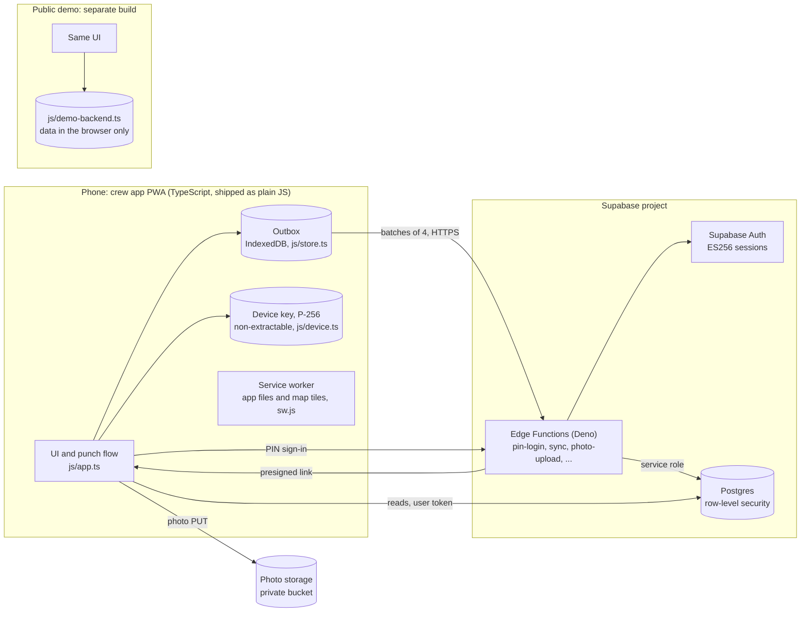

# Crew Clock design

How the app is built, why, and where it is weak. Every claim cites the file it was checked
against. Checked against the code on 2026-11-23. The crew app has not run in production; section 8
lists what is unproven. Short names: `core.ts`, `guard.ts`, `auth.ts` and `b2.ts` are in
`supabase/functions/_shared/`; `init.sql`, `auth_hook.sql` and `retention.sql` are the migrations
with those suffixes in `supabase/migrations/`.

## 1. Problem and constraints

A small construction crew in rural West Virginia needs a record of who showed up, where and when,
without paper timesheets and without tracking anyone all day (`README.md` "Why I built it").
The constraints that shaped the design:

- Weak or no signal at the job site, so a clock-in must work offline.
- Cheap phones and a crew that does not want a new app to learn: three taps, no typing.
- $0 to run: no paid services, no analytics, no third-party scripts at runtime.
- Location is read only at the clock-in or clock-out tap, and only with the worker's recorded consent.
- The repo and a demo are public, so neither may hold real crew data or a backend address.

## 2. Goals and non-goals

Goals (`PLAN.md` "Goal"):
- A beta crew of five clocks in and out in three taps, with or without signal.
- Location only at the tap, only with consent; retention limits written as code.
- A public demo that is the same app on sample data and cannot reach a backend.
- Records that are hard to fake and can be checked afterwards.

Non-goals for now (`PLAN.md` "Not now"):
- More than the five-person beta until the beta review says go.
- A native or App Store build. The web app is the beta.
- Pay-rate reports. Hours only, because payroll data raises the privacy bar.
- Continuous or background location tracking.
- Background sync on iPhone (a platform limit; the app tells the crew to open it when they have signal).
- Sign-up for other companies. One crew first.
- A custom MLS implementation. On-phone AI models and the Google Sheets nightly export are shelved.

## 3. Architecture at a glance

- The app is static files with no deploy-time build step. The source is `js/*.ts`; `npm run build`
  (esbuild, types stripped, no bundling) writes the `js/*.js` that are committed, and CI fails if
  they differ. `scripts/build-site.mts` only copies the committed files (never the `.ts`), fills
  `config.js` from the host's environment and stamps the service worker version.
- All writes of punches go through the `sync` Edge Function, which uses the service role. The
  signed-in role can only read punches (`supabase/migrations/20261022000000_init.sql:297-299`, `:346`).
- Reads for the worker and boss screens go straight to Postgres REST with the user's token, so
  row-level security decides what each person sees (`js/api-supabase.ts:162-196`).
- Four modules (`js/geo.ts`, `js/report.ts`, `js/chain.ts`, `js/risk.ts`) run on both the phone and
  the server. `scripts/sync-shared.sh` copies them and CI fails if the copies drift
  (`.github/workflows/ci.yml:54-55`, after the build-diff step at `:50-53`).
- The demo is the same files built with `--demo`. `js/api.ts:32-40` routes it to an in-browser
  backend, and the build refuses any config that names a backend (`scripts/build-site.mts:57-63`).

## 4. The life of one punch

1. **Tap.** `startPunch` checks for a consent record first. With none, the worker sees the consent
   screen; a teammate without consent is clocked in with a picture and no location
   (`js/app.ts:346-362`).
2. **Pick a job.** One rough, low-accuracy reading sorts the job list by distance. It is not saved
   or sent, and it stops when the worker picks a job or leaves the list (`js/app.ts:368-377`).
3. **Read GPS.** `locate` stamps the time from the phone clock, then watches GPS for up to 20 s and
   keeps the most accurate fix, stopping early at 20 m (`js/app.ts:417-443`, `js/geo.ts:67-107`).
   Leaving the screen or backgrounding the app aborts the watch (`js/app.ts:401-415`).
4. **Fence check.** `Geo.fenceStatus` subtracts the phone's stated accuracy from the distance to the
   job pin before comparing with the radius. No fix, or accuracy worse than 152 m, asks for a photo
   (`js/geo.ts:31-40`, `:57`). "I can't take a picture" still saves the punch (`js/app.ts:818`, `:1489`).
5. **Sign and chain.** `Device.sign` adds the device id, a per-device counter and the hash of that
   phone's previous punch, then signs a fixed-order serialization with ECDSA P-256
   (`js/device.ts:47-63`, `js/chain.ts:25-31`, `:53-58`). The key is created with
   `extractable = false` (`js/chain.ts:42-45`). If signing fails the punch is saved unsigned
   (`js/app.ts:327-329`).
6. **Outbox.** The punch, with its photo, goes into IndexedDB (`js/store.ts:47-50`).
7. **Sync.** `syncNow` runs after each save, when the browser reports it is online, when the app
   becomes visible, and every 60 s. It sends batches of four (`js/app.ts:201-253`, `:1762-1764`).
   Photos go first, straight to storage through a presigned link valid for 10 minutes; the punch
   then carries only the object key (`js/api-supabase.ts:127-148`, `supabase/functions/_shared/b2.ts:19`).
8. **Server check.** `sync` verifies the session token against the project's public keys
   (`supabase/functions/_shared/auth.ts:10-30`), then `ingestPunch`
   (`supabase/functions/_shared/core.ts:177-259`):
   - refuses a punch for another company, a crew member clocking in someone else, a punch older
     than 30 days, and most punches from or for a turned-off worker;
   - drops the coordinates, but keeps the punch, when they are impossible or the worker has no
     consent on record. The hash and signature are dropped with them;
   - verifies the signature and the chain against the device's registered key and records
     `linked`, `gap`, `replay_or_old`, `bad_signature` or `unsigned`;
   - runs the risk rules and stores the flags (`js/risk.ts:9-23`);
   - caps a phone time more than 10 minutes ahead of the server clock.
9. **Store.** A database trigger, not the phone, computes distance and fence status on insert
   (`supabase/migrations/20261022000000_init.sql:183-212`).
10. **Boss view.** An off-site status or a high-risk flag sends the boss a push with a name and a
    reason, no coordinates (`supabase/functions/sync/index.ts:17-34`). The boss's Map and Today read
    recent punches through row-level security (`js/api-supabase.ts:182-196`). A worker who is not a
    foreman or the boss can read only their own punches (`init.sql:298-299`).

## 5. Key decisions

| Decision | Option rejected | Why | Cost accepted |
| --- | --- | --- | --- |
| Never block a clock-in. A bad fix means a photo or a flag (`js/app.ts:445-453`, `core.ts:198-207`). | Refuse a punch outside the fence or without GPS. | A worker with no signal in a hollow would lose paid time through no fault of theirs. | The boss must review flags. A punch with no GPS and no photo is still recorded. |
| Benefit-of-the-doubt geofence: stated accuracy is subtracted from the distance (`js/geo.ts:31-40`). | A strict fence on the reported point. | In a simulation, at a 300 ft fence a strict rule wrongly flags 10.5% of on-site workers under tree cover and 28.1% in a hollow; this rule flags 0.1% and 0.2% (`docs/evals/geofence.md`). | In a hollow at 300 ft it passes 77.0% of people standing 1.5 times the radius away (strict: 5.8%); worst case 93.2% at 150 ft. At one mile it passes 0.0%. The fairness also drops when a phone overstates its accuracy (4.8% wrongly flagged at 300 ft). |
| Location only inside the punch flow, with an append-only consent record (`js/app.ts:70-105`, `supabase/migrations/20261023100000_location_consents.sql:20-30`). | Background tracking or periodic check-ins. | The promise to the crew is no all-day tracking (`docs/PRIVACY.md`). Tests fail if a location read appears elsewhere (`tests/location.test.ts`). | No evidence of where anyone was between punches. The server re-checks consent and strips coordinates without it (`core.ts:203-207`, `:229`). |
| Signed, hash-chained punches with a key that cannot be exported (`js/chain.ts`, `js/device.ts`). | Trust the row in the database. | An edit after the fact no longer matches what the phone signed; a missing punch shows as a gap at ingest. | Unsigned punches from phones without WebCrypto are accepted and flagged. Verification after ingest is not shipped in the crew app (section 6). |
| Supabase Auth sessions signed with asymmetric (ES256) keys; functions verify against public keys and refuse HS256 and `alg: none` (`auth.ts:7-19`). | The first version, where `pin-login` signed tokens with the shared JWT secret (commit `0534415`, 2026-10-22). | No function holds a secret that could mint a session. Phones keep a refresh token, never the PIN (`js/api-supabase.ts:51-53`). | A sign-in hook and trigger in SQL to add claims and end sessions (`supabase/migrations/20261023000000_auth_hook.sql`). The refresh token sits in `localStorage`. |
| The demo is a separate build that cannot reach a backend (`.github/workflows/pages.yml:38`, `scripts/build-site.mts:57-63`). | One deployment with a demo switch. | A visitor to a public portfolio demo must never be one config mistake away from crew data. Server CORS allows only the crew app's address (`guard.ts:76-84`). | Two builds and two hosts to keep working. Push alerts, which need a server, are not in the demo (`README.md` table). |
| Strict TypeScript stripped to classic scripts, no deploy-time build step, no SDK (`js/api-supabase.ts:1`). | A framework and bundler. | Small download on cheap phones; the committed `js/*.js` are what ships, and CI checks they match `js/*.ts`. | `js/app.ts` is one 1,872-line file with hand-written rendering. The type strip needs `npm ci` (esbuild) before `npm run build`. |
| Postgres with row-level security instead of the original Google Sheets backend (`backend/Code.gs`, kept for history). | Keep the Sheet as the database. | The commits do not state one reason. What the code shows: the Sheet backend kept PINs in a tab and on the phone (`docs/PRIVACY.md` S5, `backend/Code.gs:10`), and had no per-person read rules. | A real server to set up and operate. The old adapter path is still in `js/api.ts:7-38`, and a non-demo build does not yet refuse it (`docs/PRIVACY.md` S5 is marked "to build"). |

## 6. Threat model

| Who | What they could try | What stops or detects it | What does not |
| --- | --- | --- | --- |
| A worker faking location | A mock-location app, or clocking in from near the site. | Flags for an identical spot on another day, perfect accuracy, and impossible travel speed (`js/risk.ts:43-52`). The server computes the fence status itself. | A spoofing app that adds realistic jitter passes. The lenient fence passes many people just outside it (section 5). The fallback is photos and spot checks. |
| A worker faking time | Changing the phone clock; holding a punch and sending it later. | The server records its own receive time, flags a clock more than 5 minutes ahead and a punch sent over 12 hours late, and caps future times (`js/risk.ts:64-67`, `core.ts:172`, `:245`). | A clock set back by less than 12 hours raises no flag. |
| A worker dropping a punch | Deleting a queued punch before it sends. | The next punch from that phone arrives with a counter gap and is flagged (`js/chain.ts:67-71`, `js/risk.ts:70`). | It is a low-level flag. Storage cleared by the browser looks the same. |
| A boss or database admin editing records later | Changing a time, or deleting a punch. | The signed-in role has no write access to punches (`init.sql:346`). An edited row no longer matches its stored hash and signature. | Anyone with the service-role key or dashboard access can edit rows, and nothing in the crew app re-checks them: `verifyPunch` runs only at ingest (`core.ts:218`), and the boss's "Verified" line is demo only because the crew app's team view carries no public keys (`js/app.ts:1037-1044`, `README.md` table). `Chain.verifyAll` also does not flag a punch removed from the middle of the list; it flags only a repeated counter or a wrong link between consecutive counters (`js/chain.ts:94-101`). Hashes and signatures are deleted with the GPS at 90 days (`supabase/migrations/20261024000000_retention.sql:96-105`). |
| A lost or shared phone | Clocking in as the phone's owner; one phone used for two people. | A new PIN or turning the worker off deletes their sessions (`auth_hook.sql:30-41`); turning them off also revokes their devices (`retention.sql:141-150`). Two people on one phone within 15 minutes is flagged (`js/risk.ts:54-59`). | Until the boss acts, the phone stays signed in with no PIN prompt on reopening. An access token already issued stays valid until it expires. |
| Someone guessing PINs | Trying PINs for a name on the crew list. | Five wrong PINs lock that person for 15 minutes; the third lock in a day blocks the PIN until the boss resets it. Limits per IP and per company per hour (`guard.ts:9-42`). PINs are stored as PBKDF2 hashes (`core.ts:34-42`). | PINs can be four digits. The per-company cap lets an attacker pause new sign-ins for an hour (`guard.ts:32-35`). Anyone with the company code can list crew names, with a per-IP limit (`js/api-supabase.ts:152-155`, `supabase/functions/crew-list/index.ts`). |
| A demo visitor | Reaching real data from the public demo. | The demo build has no backend address and CI tests that it makes no off-origin request except map tiles (`tests/site.test.ts:38-50`, `tests/e2e-demo.js:125-135`). | Map tile hosts see the visitor's IP. Neither build sends a Content-Security-Policy (`index.html`, `_headers`), so an injected script in the crew app could read the refresh token in `localStorage` (`js/api-supabase.ts:6`, `:15-17`). |
| A leaked repo | Finding secrets or personal data in a public repo. | Real config comes from the host's environment at build time (`scripts/build-site.mts:24-46`). CI scans the whole history for secrets (`.github/workflows/ci.yml:11-19`). | The scanner matches key patterns only. Keeping names and places out relies on review. |

## 7. Failure handling

| Situation | What happens | Where |
| --- | --- | --- |
| No signal | The punch is saved on the phone and the screen says so. Sync is skipped while offline and retried when the browser reports online, when the app is reopened, and every 60 s. | `js/app.ts:208`, `:305-318`, `:1762-1764` |
| Bad or no GPS fix | A photo is asked for; the punch saves either way. Impossible coordinates are dropped on the server and flagged. | `js/geo.ts:57`, `js/app.ts:445-453`, `core.ts:198-239` |
| Photo upload fails | That punch stays queued with its photo; the rest of the batch still sends. | `js/api-supabase.ts:127-148` |
| Server or database error | The server rejects only on client errors; anything else fails the request and the batch stays in the outbox. | `core.ts:156-159`, `js/app.ts:240-246` |
| Rejected punch | Permission refusals are dropped. Any other refusal is kept as a stub (no GPS, no photo) and shown as "not sent, tell the boss". Stubs are never resent. | `js/app.ts:179-199`, `:220-233`, `:302-304` |
| Turned-off worker | Their own punches made up to 15 minutes after being turned off are kept and flagged; everything else is refused. | `core.ts:123`, `:187-196`, `:238` |
| Expired session | The token is refreshed when it has under 60 s left or on a 401. If the refresh is refused the phone asks for the PIN; if it only failed (offline, 5xx, 429) the session is kept. Queued items wait for the same person to sign in. | `js/api-supabase.ts:56-89`, `js/app.ts:174-178`, `:244` |
| Storage unavailable (private mode) | The outbox falls back to memory and a banner says to keep the tab open until it says Sent. | `js/store.ts:7-8`, `:46-63`, `:95-108`, `js/app.ts:580` |

Not handled:
- Retry is a fixed 60 s timer with no backoff or jitter (`js/app.ts:1764`).
- The app never asks for persistent storage (no `navigator.storage.persist` anywhere in `js/` or
  `sw.js`), so a browser under storage pressure may evict the outbox and the device key.
- A punch that waits more than 30 days on the phone is refused as too old (`core.ts:186`).
- The turned-off grace period is reachable only while the phone still has a valid access token,
  because turning a worker off deletes their sessions. This is from reading the code, not a test.
- A rejected punch's GPS and photo are discarded with the stub; there is no way to correct and resend it.
- An old sync can finish a token refresh after the next person signs in and overwrite their saved
  session (`HANDOFF.md` "Known limits").

## 8. What has not been proven

- The crew app has never run against a real Supabase project, storage bucket or push service. The
  browser test for the Supabase adapter runs against a fake server (`tests/e2e-supabase.js:1-7`),
  and setup is blocked on accounts (`PLAN.md` M2.1 to M2.3, `README.md` "The crew app is not live yet").
- It has never been used by the crew or installed on their phones (`PLAN.md` M2.5). Browser tests
  run in Chromium only (`tests/browser.js`).
- Retention is a tested SQL function, but it has never run on a schedule (`PLAN.md` M2.4).
- The geofence numbers are simulated from an assumed error model, not field data
  (`docs/evals/geofence.md` "What this is and is not").
- On-phone AI models are shelved: both builds ship `onPhoneAi` false (`scripts/build-site.mts:51-55`).
  Their downloads were never tested from a real phone (`HANDOFF.md` "Known limits").
- The rate limiter's reading of proxy headers is to be checked against real headers at setup
  (`supabase/functions/_shared/guard.ts:44-47`).
- The crew app host's response headers in `_headers` have never been served by that host
  (`PLAN.md` M2.2).
